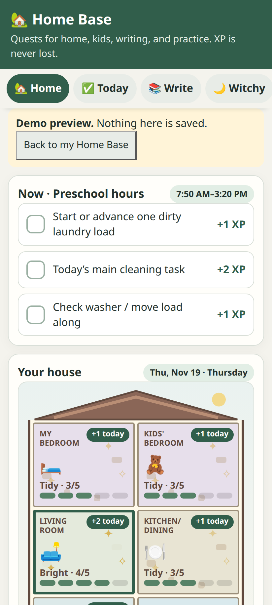
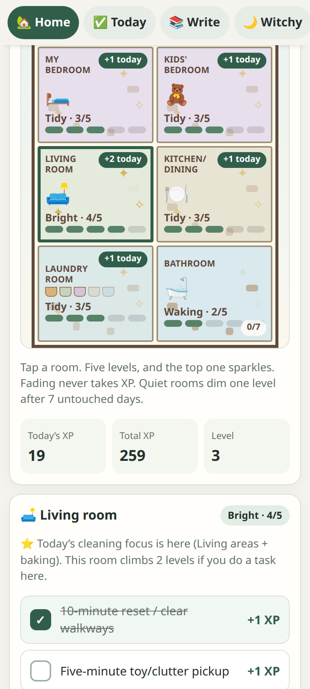
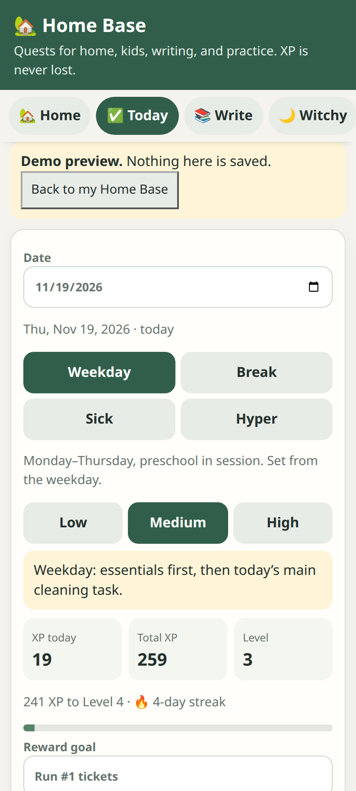
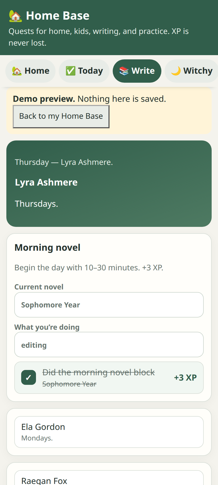
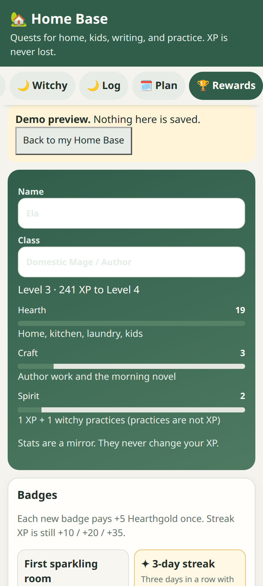

# Home Base

Ela’s quest board for home, kids, writing, and witchy practice. It is a website you install on your Android home screen. It works offline. Your XP, gold, and checkmarks stay on your phone.

The site address, after Pages is on:

**https://elagordon216-byte.github.io/home-base/**

## Turn it on (once)

1. Open this repo on GitHub: [elagordon216-byte/home-base](https://github.com/elagordon216-byte/home-base).
2. Tap **Settings**, then **Pages**.
3. Under **Build and deployment**, set **Source** to **Deploy from a branch**.
4. Set **Branch** to `main` and the folder to **`/ (root)`**.
5. Tap **Save**. Wait until GitHub says the site is live. The first time can take a minute or two.

There is no Actions workflow to switch on. The files are already in the root of `main`.

## Put it on your phone

1. Open Chrome (not the GitHub app) and go to https://elagordon216-byte.github.io/home-base/
2. Tap the Chrome menu (three dots).
3. Tap **Add to Home screen** or **Install app**.
4. Open **Home Base** from your home screen after that. That is the copy that keeps your data.

## Bring in your v2 backup

1. In the app, open **Today**.
2. Scroll to **Backup & restore**.
3. Tap **Restore from a file** and choose `home-base-backup-YYYY-MM-DD.json` from the old app (the file whose backup says schema 2).
4. Confirm. XP, the ledger, Hearthgold, purchases, streaks, levels, tasks, projects, and notes come over. Rooms start at Waking. XP is not reduced. Badges are not created for old streaks, focus time, moon or Sabbat lists, or a past Bad Day. Those start from what you do after the import. A backup from this app keeps any badges it already has.

A backup you export from this app uses schema 3 and the same kind of filename. You can import that file later, on this phone or another. Export one every so often and keep it somewhere safe (Drive, or an email to yourself).

## Day to day

- **Home** is the house. Rooms brighten when you tend them and dim slowly when you don’t. Fading never takes XP.
- **Today** is the checklist, the Now card, essentials, and the weekly quest.
- **Write** opens on the day’s pen name. Tuesday and Sunday are no-writing days. The morning novel is optional those days and still pays +3 XP if you do it.
- **Witchy**, **Log**, **Plan**, and **Rewards** are the same jobs as v2, plus the character sheet.

After the first visit, the app works with no signal. When a new version is published, the next time you open it you may see “Home Base updated.” Close it and open it again. Your saved progress stays on the phone.

## Still waiting on you

- **Google Drive auto-backup** is a labeled placeholder in Today. It does not sign in and it does not upload. Use Export.
- **Weekend/Break daytime** on the Now card is one block, 7:50 AM–5:00 PM, until you say otherwise. The card is marked unconfirmed.
- **Boss battles** are not in this version.

## Phone-width screens

More shots are in `screenshots/` (witchy, plan, log, hyperfocus).
